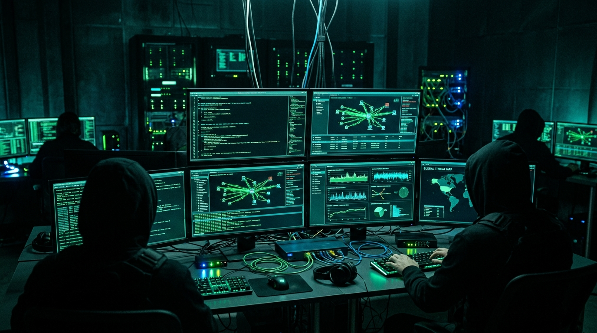

# ABHISHEK TIWARI // Offensive Security & Red Team Portfolio Website

A cybersecurity, terminal-themed portfolio web application built with authentic terminal styling, rich visual telemetry, interactive CLI sandbox, CRT phosphor scanline shaders, Web Audio synthesizer effects, and responsive mobile-first architecture.



---

## ⚡ Features & Capabilities

- **Authentic Terminal Aesthetic**:
  - JetBrains Mono typography with matrix green (`#00FF41`), electric cyan (`#00e3fd`), and dark obsidian palettes.
  - Interactive CRT scanline shader with real-time toggle.
  - Fullscreen Matrix digital rain canvas overlay (interactive easter egg via `:matrix` or header toggle).
  - Web Audio API retro synthesized audio FX (tactile key clicks, access-granted chimes, error buzzes, boot blips) with 1-click mute toggle.
  - Real-time diagnostic boot sequence and live system uptime clock counter.

- **Interactive CLI Sandbox (`tty2: live-sandbox`)**:
  - Command input parsing with auto-scroll, formatted outputs, and colorized badges.
  - History buffer with `Up` and `Down` arrow keys.
  - Tab autocompletion for quick payloads.
  - Quick-trigger command pills (`help`, `whoami`, `skills`, `projects`, `certs`, `writeups`, `contact`, `matrix`, `clear`).

- **Multi-View Navigational System**:
  - `~/home` - Operator ID, telemetry gauges (Vulns found, CVEs, HTB Rank, Clearance), CLI sandbox, and featured exploit repositories.
  - `~/about` - Detailed operator dossier, red team operational philosophy, engagement timeline, and tactical hardware specifications.
  - `~/skills` - Weapons matrix with category filter pills, animated progress meters, and offensive tooling arsenal.
  - `~/projects` - Filterable grid of 6+ exploits and security tools with interactive technical dossier modals (architecture diagrams, PoC snippets, CVE links).
  - `~/certs` - OSCP, CISSP, CRTO, AWS Security Specialty, HTB Pro Hacker, and TryHackMe accreditations with signature status.
  - `~/writeups` - Published CVE teardowns (CVE-2023-3814, CVE-2024-2190, CVE-2024-5103) with expandable code snippets and responsible disclosure timelines.
  - `~/contact` - Encrypted transmission uplink simulator, direct channels (Signal, Matrix, Email), and 4096-bit PGP public key viewer with 1-click copy & `.asc` download.

- **Responsive Mobile & Desktop Design**:
  - Sticky mobile dock with quick vim-style triggers (`:help`, `:whoami`, `:skills`, `:projects`, `:certs`, `:contact`) and quick shell prompt.
  - Clean centered workstation framing on desktop viewports.
  - Zero external npm build dependencies — runs natively in any modern browser!

---

## 🚀 How to Run Locally

You can run this portfolio immediately with any static file server:

### Option 1: Python
```bash
python -m http.server 8080
```
Then visit [http://localhost:8080](http://localhost:8080)

### Option 2: Node.js (npx)
```bash
npx serve .
```

### Option 3: Direct File Access
Simply double-click `index.html` to open it directly in your browser.

---

## 📁 Project Structure

```
portfolio/
├── index.html           # Main semantic structure with all tabs, modals, and widgets
├── style.css            # Custom terminal stylesheet with tokens, CRT scanlines & responsive rules
├── app.js               # Application logic, CLI parser, audio synthesizer & state management
├── README.md            # Documentation and instructions
└── assets/
    └── images/
        ├── avatar.jpg            # Operator circular profile avatar
        ├── hero-banner.jpg       # Cyber warfare command center hero banner
        ├── zerodayx.jpg          # ZeroDayX autonomous AI pentest platform preview
        ├── fuzzer-scanner.jpg    # Fuzzer terminal telemetry screen
        ├── cloud-security.jpg    # CloudSpectre IAM attack path graph
        └── firmware-reverse.jpg  # FirmGhost binary disassembly & Ghidra workstation
```

---

## 🛠️ Customization Guide

1. **Operator Details**:
   - Open `index.html` and search for `ABHISHEK TIWARI` to change your name, title, handle, and bio.
2. **Contact & PGP**:
   - Update your Signal handle, Matrix ID, email address, and PGP key block in the `~/contact` section of `index.html` and in `app.js`.
3. **Projects & Exploits**:
   - Edit or add projects inside `projectsData` in [app.js](file:///c:/Users/dell/OneDrive/Documents/portfolio/app.js) to customize architecture diagrams, sample PoC terminal commands, and tags.
